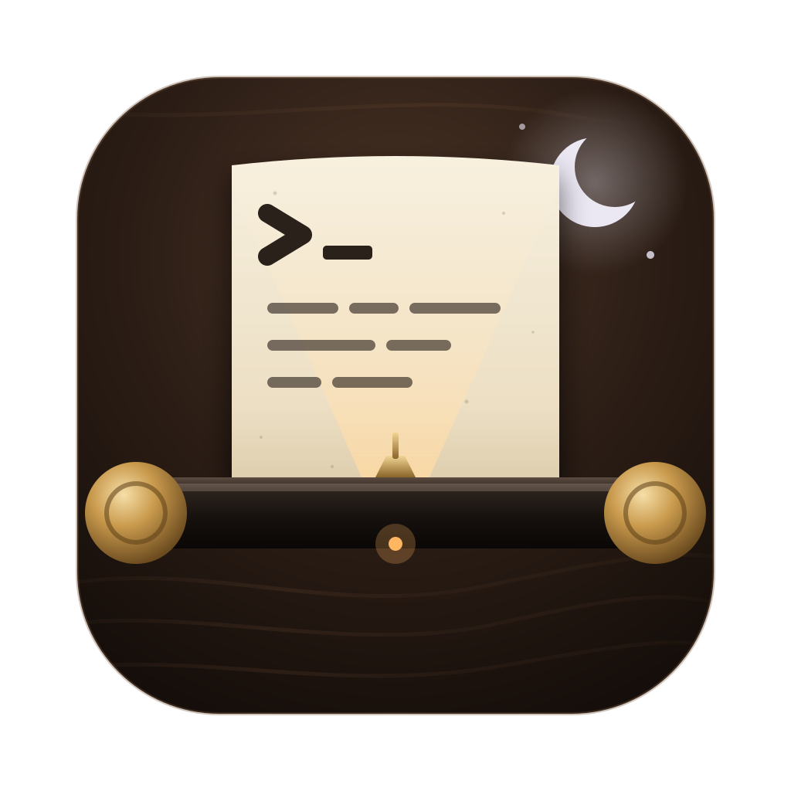
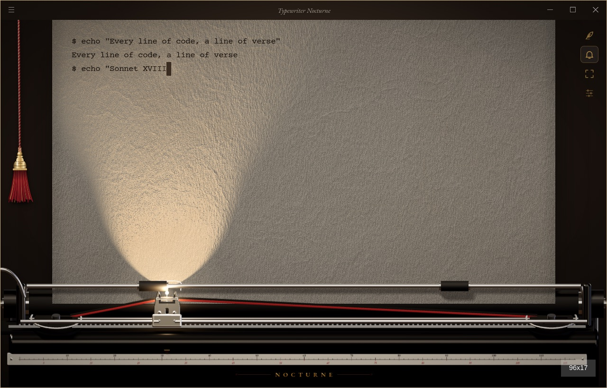
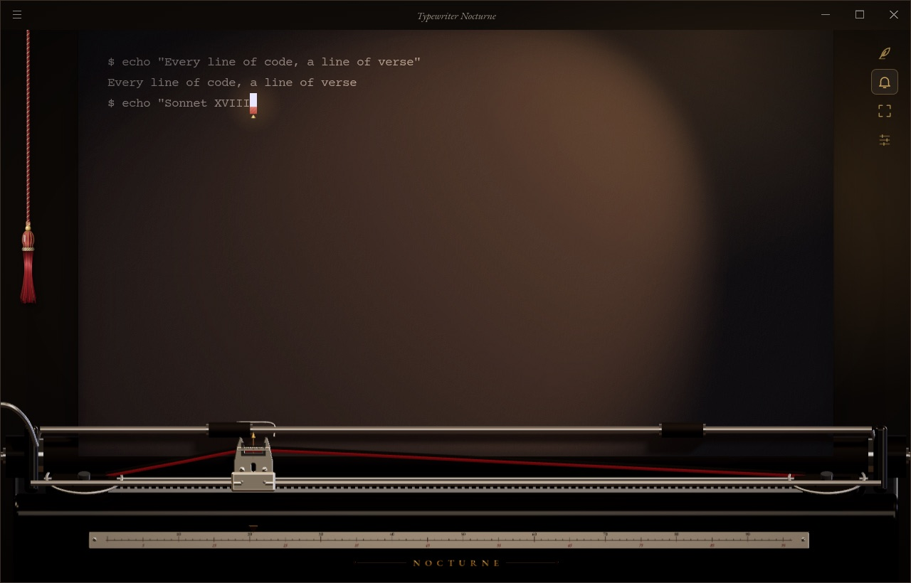
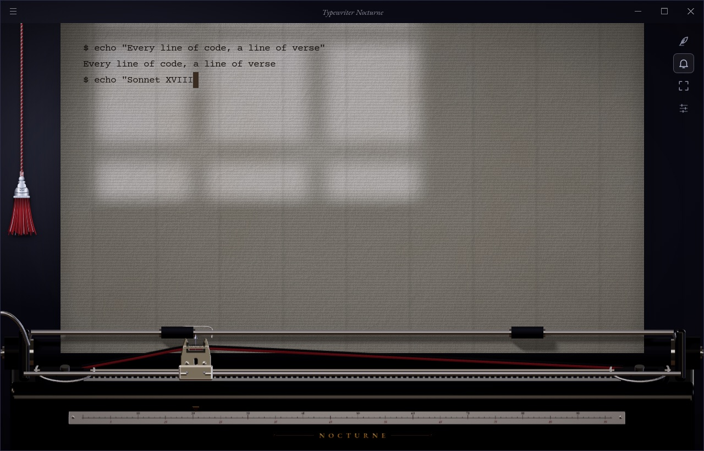
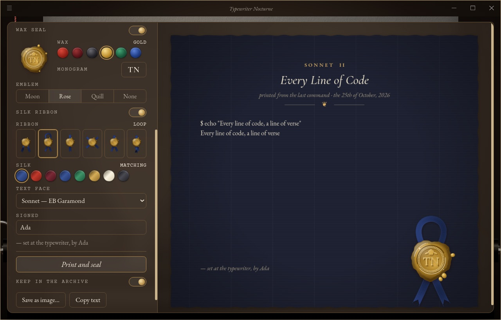
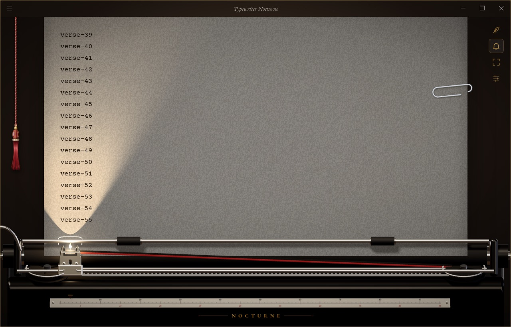
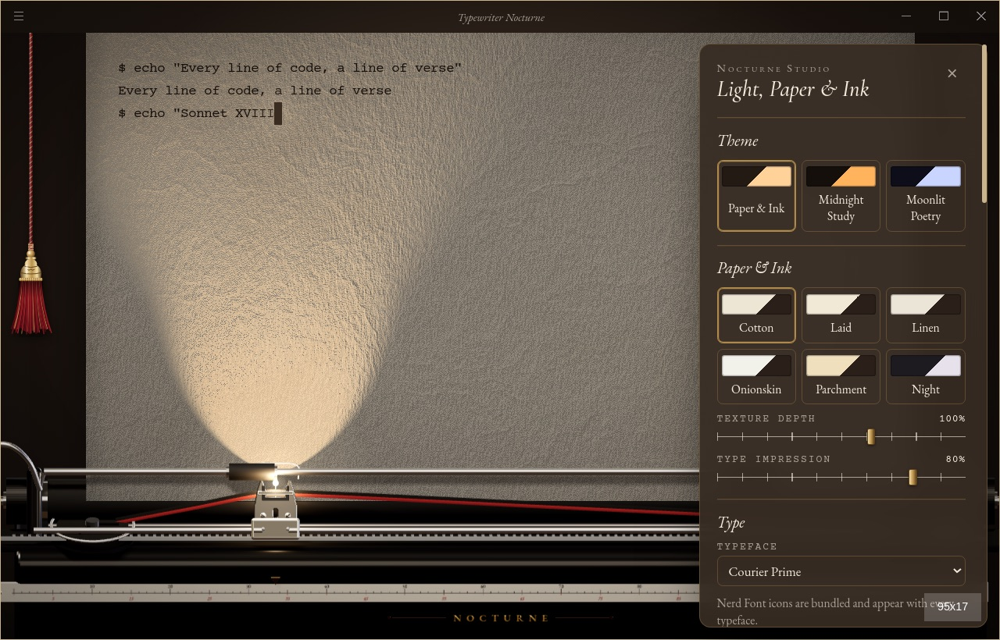
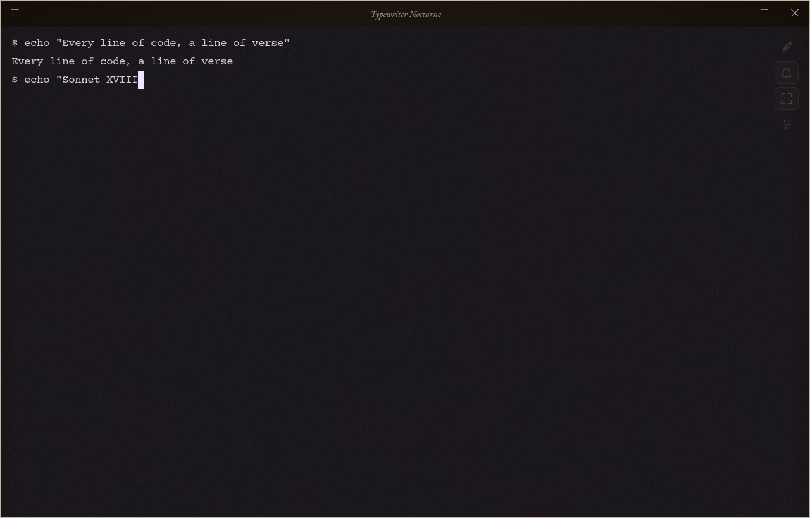

<p align="center">
  
</p>

<h1 align="center">Typewriter Nocturne</h1>

<p align="center"><em>Every line of code should feel like writing poetry.</em></p>

<p align="center">
  <a href="https://github.com/Chaosnap/Typewriter-Nocturne/actions/workflows/ci.yml"></a>
</p>

Typewriter Nocturne is a cross-platform terminal with the soul of a writing desk: your shell typed onto a
sheet of paper, a brass-and-enamel typewriter whose head follows the cursor, a lamp with a pull cord, the
sound of type bars. Underneath it is a complete, real terminal: a fork of [Hyper](https://github.com/vercel/hyper)
with xterm.js and node-pty running your actual shell, so zsh, bash, PowerShell, Git, Python, Node.js, SSH,
Vim, tmux and every other TUI program work as they do in any good terminal.

**[Documentation](https://chaosnap.github.io/Typewriter-Nocturne/)** ·
**[中文文档](https://chaosnap.github.io/Typewriter-Nocturne/zh/)** ·
**[Interactive demo](https://chaosnap.github.io/Typewriter-Nocturne/demo/)** ·
**[Download](https://github.com/Chaosnap/Typewriter-Nocturne/releases)**



<table>
  <tr>
    <td width="50%"><br><em>Midnight Study, night paper</em></td>
    <td width="50%"><br><em>Moonlit Poetry, laid paper</em></td>
  </tr>
  <tr>
    <td width="50%"><br><em>The Press: the last command on night paper, gold seal, looped ribbon</em></td>
    <td width="50%"><br><em>The paper clip scrollbar</em></td>
  </tr>
  <tr>
    <td width="50%"><br><em>Nocturne Studio</em></td>
    <td width="50%"><br><em>Focus Mode, dark background</em></td>
  </tr>
</table>

*Screenshots of the packaged app, taken by its end-to-end tests on GitHub Actions (CI runners have no GPU,
so the typewriter is drawn on the CPU there with Quality set to High). More in the
[gallery](https://chaosnap.github.io/Typewriter-Nocturne/guide/gallery).*

> **Status: alpha.** The latest version is on the [Releases](https://github.com/Chaosnap/Typewriter-Nocturne/releases)
> page and what changed in each one is in the [changelog](CHANGELOG.md). See
> [docs/ARCHITECTURE.md](docs/ARCHITECTURE.md) for how it is built and what comes next.

## Features

* **A 3D typewriter** with physically based materials and soft shadows. The type head rides a rail with one
  rack tooth per terminal column, moves with escapement physics, sways on its pivot and strikes the platen.
* **Light that behaves like light**: inverse-square falloff, Lambert's cosine law, a soft spot cone that draws a
  clean triangle up the page from the type head, moonlight through an upright window whose panes, slant and
  place you choose; the lit paper shows only its soft, broad relief. Brightness, beam angle, beam shape, aim and
  the light itself (carriage lamp, desk lamp or window) are adjustable, and a slender theatre-curtain
  **pull cord** ending in a silk tassel switches the lamp (hide it in the Studio if you like). On a dark sheet
  the lamp adds its own pool of light with a soft bloom; the room never dims the page below 4.5:1 contrast.
* **A typewriter's cursor**: the block carries the red half of a two-colour ribbon, which lifts with every key
  you strike as the ribbon vibrator does, over a gilt type-guide pointer. Or choose a quill pen standing at the
  insertion point with its nib on the line, breathing softly while the terminal waits.
* **Paper and ink**: six papers, from smooth onionskin (the default) and felted cotton rag to parchment, each
  with its own texture in the light as out of it, as narrow as a letter or as wide as the whole platen; freshly typed characters
  land heavy and settle into print, and selected text dissolves like ink and re-forms instead of sitting in a
  flat box.
* **A paper clip for a scrollbar**: a Gem clip slid onto the edge of the sheet, it glides and leans as you scroll and
  can be dragged (or use a translucent bar, or the system one). Double-click a bail roller to roll the paper
  to the top or the bottom.
* **Sounds of the machine**, synthesised: type bars, space bar, carriage return, margin bell, the platen
  ratchet when you recall history with ↑/↓, the escapement on ←/→, the tabulator, placed in stereo where the
  head stands.
* **Input methods**: pinyin, kana and hangul compositions strike keys while you compose, and the committed text
  lands as a firm double strike, without touching the IME or what the shell receives.
* **Fonts**: Courier Prime and IBM Plex Mono bundled, Nerd Font presets, any installed family, and the
  Symbols Nerd Font bundled so Nerd Font icons appear with every face.
* **The Press**: print a snippet, the selection, the screen or the last command with its output as a folio set
  like a sonnet, previewed live as you choose: the paper, the wax seal (or none) with its colour, monogram,
  emblem and satin ribbon laid one of six ways, a face for the text (an upright book face like a printed sonnet, or any installed
  font), and your name to sign it. Keep it in the local **Archive**, rename it, save it as PNG or copy it.
* **Focus Mode** with a paper, dark or custom background, keeping the paper's effects or the lamp if you
  want them; a Studio for every setting; and an **Auto quality** that keeps the terminal fast on computers
  without a usable GPU.

## Principles

* **A real terminal first.** No fake prompt, no reimplemented parser or PTY. Exit codes, environment, working
  directory, keyboard behaviour, IME input and bracketed paste come straight from Hyper and your shell.
* **Effects never touch your data.** Lighting and typewriter feedback sit on top of the terminal; they never
  delay, intercept or rewrite keystrokes or program output. Every effect can be turned off, and Focus Mode
  removes all decoration at once. Terminal text is read only when you print it, and folios stay on your
  computer.
* **Typography that respects the grid.** Strict monospace cells for the terminal, CJK double-width characters
  intact; serif type only for the chrome around it.
* **Built in the cloud.** Every dependency install, native rebuild, test and installer is produced by GitHub
  Actions. See [docs/INSTALL.md](docs/INSTALL.md) for downloads and the caveats of unsigned builds.

## Downloads

Development builds are attached to each [CI run](https://github.com/Chaosnap/Typewriter-Nocturne/actions/workflows/ci.yml)
(macOS arm64/x64 DMG, Windows x64 installer, Linux x64 AppImage and DEB). Tagged versions are published on the
[Releases](https://github.com/Chaosnap/Typewriter-Nocturne/releases) page with SHA-256 checksums.

## Contributing

Edit, commit and push; GitHub Actions does the rest:

```text
change code → push → CI (lint · types · unit tests · licences · packages · e2e on a real PTY) → read logs → fix → push
```

Upstream tracking and merge instructions are in [UPSTREAM.md](UPSTREAM.md).

## Licence

MIT. Typewriter Nocturne is built on [Hyper](https://github.com/vercel/hyper), © Vercel, Inc., also MIT; the
original licence is kept in [LICENSE](LICENSE) and shipped in every installer under `licenses/`. All artwork in
`assets/nocturne/` is original and released under the same licence.
