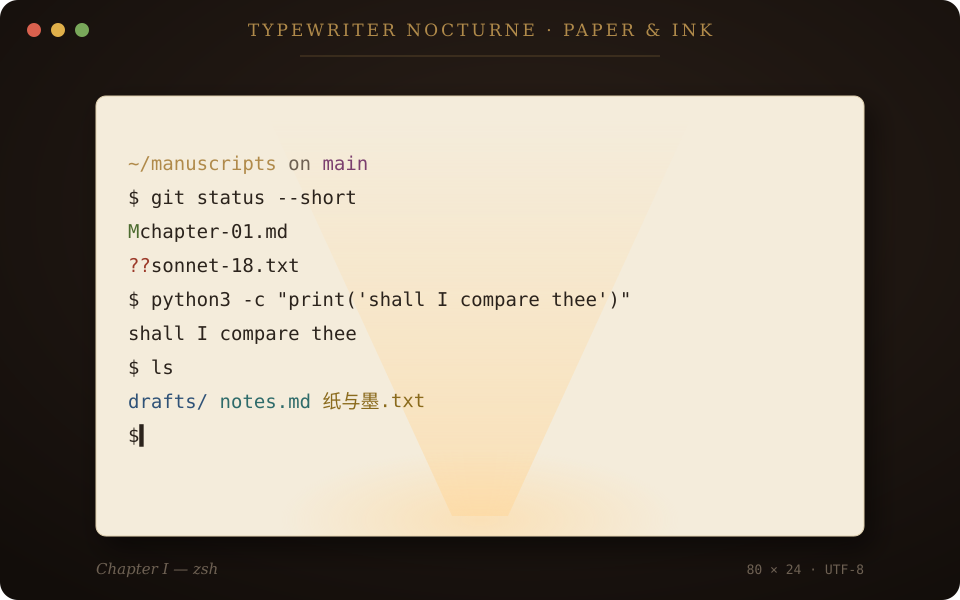
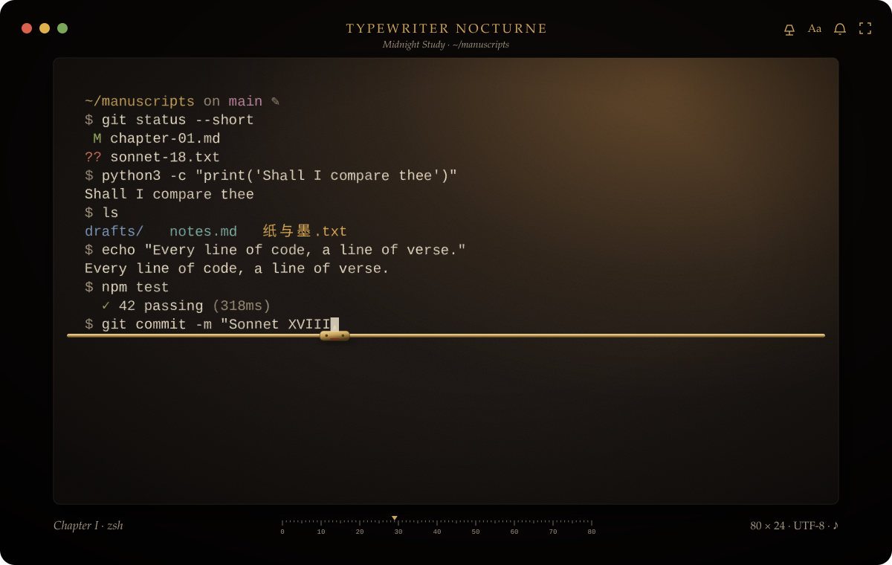
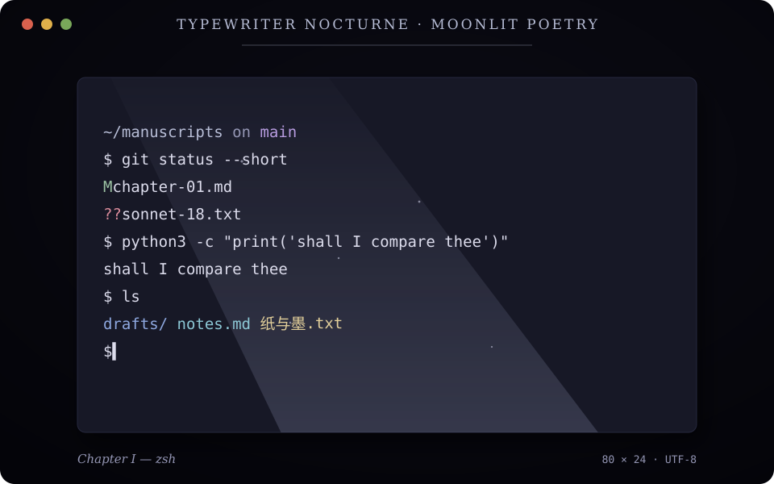

<p align="center">
  
</p>

<h1 align="center">Typewriter Nocturne</h1>

<p align="center"><em>Every line of code should feel like writing poetry.</em></p>

<p align="center">
  <a href="https://github.com/Chaosnap/Typewriter-Nocturne/actions/workflows/ci.yml"></a>
</p>

Typewriter Nocturne is a cross-platform terminal with the soul of a writing desk: paper and ink, brass
and walnut, a carriage lamp, the sound of type bars. Underneath it is a complete, real terminal: it is a
fork of [Hyper](https://github.com/vercel/hyper), with xterm.js and node-pty running your actual shell, so
zsh, bash, PowerShell, Git, Python, Node.js, SSH, Vim, tmux and every other TUI program work as they do in
any good terminal.

> **Status: early development (Phase 1 of 6).** The fork, rebrand, cloud build pipeline and architecture are in
> place; the literary themes, Lighting Studio and typewriter engine are being built next. See
> [docs/ARCHITECTURE.md](docs/ARCHITECTURE.md) for the plan and what is already implemented.

| Paper & Ink | Midnight Study | Moonlit Poetry |
| --- | --- | --- |
|  |  |  |

*Theme concept previews: original artwork, not screenshots. Screenshots of the real app come from CI.*

## Principles

* **A real terminal first.** No fake prompt, no reimplemented parser or PTY. Exit codes, environment, working
  directory, keyboard behaviour, IME input and bracketed paste come straight from Hyper and your shell.
* **Effects never touch your data.** Lighting and typewriter feedback sit on top of the terminal; they never
  delay, intercept or rewrite keystrokes or program output. Every effect can be turned off, and Focus Mode
  removes all decoration at once.
* **Typography that respects the grid.** Strict monospace cells for the terminal, CJK double-width characters
  intact; serif type only for the chrome around it.
* **Built in the cloud.** Every dependency install, native rebuild, test and installer is produced by GitHub
  Actions. See [docs/INSTALL.md](docs/INSTALL.md) for downloads and the caveats of unsigned builds.

## Downloads

Development builds are attached to each [CI run](https://github.com/Chaosnap/Typewriter-Nocturne/actions/workflows/ci.yml)
(macOS arm64/x64 DMG, Windows x64 installer, Linux x64 AppImage and DEB). Tagged versions are published on the
[Releases](https://github.com/Chaosnap/Typewriter-Nocturne/releases) page with SHA-256 checksums.

## Contributing

Edit, commit and push; GitHub Actions does the rest:

```text
change code → push → CI (lint · types · unit tests · licences · packages · e2e on a real PTY) → read logs → fix → push
```

Upstream tracking and merge instructions are in [UPSTREAM.md](UPSTREAM.md).

## Licence

MIT. Typewriter Nocturne is built on [Hyper](https://github.com/vercel/hyper), © Vercel, Inc., also MIT; the
original licence is kept in [LICENSE](LICENSE) and shipped in every installer under `licenses/`. All artwork in
`assets/nocturne/` is original and released under the same licence.
