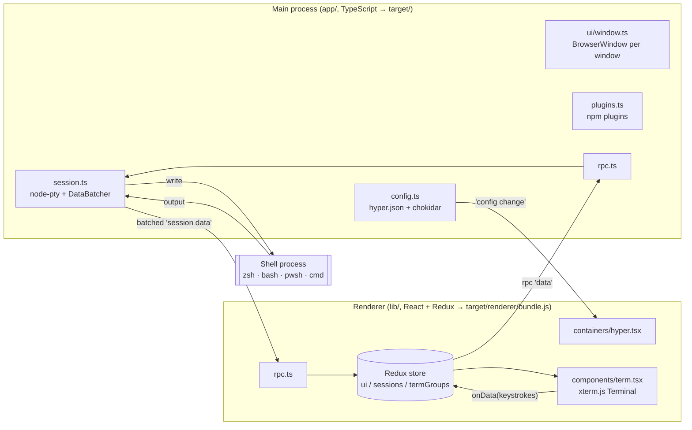
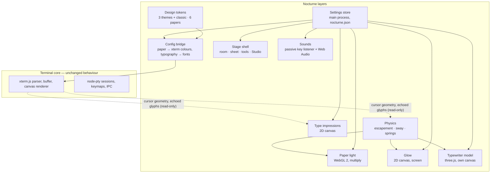

# Typewriter Nocturne — Architecture

> Status: Phase 1 (architecture investigation) — written against the pinned upstream commit
> `30ec0a2a91de17eeb32dd71998fe8a8ec59f98eb`. Sections marked **Plan** describe work that is not
> implemented yet; everything else describes code that exists in this repository.

Typewriter Nocturne is a fork of [Hyper](https://github.com/vercel/hyper). Hyper supplies the real
terminal: Electron windows, `node-pty` processes, the xterm.js parser/buffer/renderer, tabs, split
panes, configuration and the plugin API. Nocturne adds a literary visual system on top of it without
replacing or intercepting any of that machinery.

---

## 1. Choosing the upstream base

| | Stable `v3.4.1` | Canary `v4.0.0-canary.5` | **Canary HEAD `30ec0a2a` (chosen)** |
| --- | --- | --- | --- |
| Date | 2023-01-08 | 2023-07-13 | 2026-08-21 (+407 commits after canary.5) |
| Electron | 20.3.6 | 22.x | 22.3.25 |
| xterm.js | 4.19.0 | 5.x | 5.3.0 (canvas, webgl, image, ligatures, unicode11 addons) |
| node-pty | 0.10.1 | 1.0.0 | 1.0.0 (+ upstream patch for Windows) |
| React / TS | 17 / 4.9 | 18 / 5.x | 18.2 / 5.4.5 |
| Package manager | yarn 1 | yarn 1 | pnpm 10.33 (`node-linker=hoisted`) |
| Config | `~/.hyper.js` (executable JS) | `hyper.json` (data + JSON schema) | `hyper.json` |

**Decision:** fork canary HEAD and pin it.

* xterm.js 5.3 is required for what we build: the canvas/WebGL renderer addons, `minimumContrastRatio`,
  `cursorWidth`, proposed-API decorations, the image addon and correct Unicode 11 widths for CJK.
  Stable 3.4.1 ships xterm 4.19.
* Canary replaced the executable `~/.hyper.js` with a JSON config validated by a generated schema. A data-only
  config is the right foundation for "external theme files must never execute code".
* The 2026 commits only switch the package manager to pnpm and delete a workflow; the terminal code is the
  canary that Hyper's own users ran for years.

**Known risks of this base (tracked, not hidden):**

1. **Electron 22 is end-of-life** (security support ended October 2023). Upgrading Electron means moving
   `electron-mksnapshot`, `node-pty` (native rebuild), `@electron/remote` and the V8 snapshot together. It is
   scheduled for Phase 5 and will be validated entirely in CI. Until then, do not use this build for
   untrusted remote content — the renderer only ever loads local files (see §8).
2. **Upstream is quiet.** Two commits landed between April 2024 and August 2026, and upstream CI is currently
   red: every run fails at *Set up job* because it still uses the retired `actions/upload-artifact@v3`.
   We maintain our own CI (§7) and take upstream fixes selectively.
3. **Canary label.** The package version upstream is `4.0.0-canary.5`; we version independently from `0.1.0`.

### Upstream tracking

* `upstream` remote → `https://github.com/vercel/hyper.git` (push disabled locally).
* Branch `upstream-canary` in this repository = the exact upstream commit we forked from.
* Every intentional change to an upstream file carries a `// [nocturne]` comment, so
  `git diff upstream-canary -- app lib` shows the complete patch surface.
* Merge procedure: see [UPSTREAM.md](../UPSTREAM.md).

## 2. Licences

* Hyper is MIT (`LICENSE`, Copyright © 2018 Vercel, Inc.). The licence text is kept unchanged and shipped in every
  package under `resources/licenses/`. This project adds its own MIT copyright line for new code.
* Key runtime dependencies are MIT (Electron, xterm.js and all addons, node-pty, React, Redux) or similarly
  permissive (ISC, BSD, Apache-2.0).
* CI enforces this: `bin/ci/check-licenses.js` runs `pnpm licenses list --prod` for the renderer bundle and the
  packaged app and **fails the build** on GPL/AGPL/SSPL/BUSL dependencies; LGPL/MPL/unknown licences are
  reported as warnings for review.
* Bundled fonts (Phase 3) are under the SIL Open Font License 1.1, which permits bundling in MIT software when the
  licence text travels with the fonts.
* All artwork is original and authored as SVG in `assets/nocturne/` (see `docs/ASSETS.md` from Phase 2).

## 3. Process model

* **Keystrokes:** `xterm.onData` → `sendSessionData` action → `rpc.emit('data')` → `Session.write` → `pty.write`.
  Hyper's keymap layer (Mousetrap) intercepts registered shortcuts *before* xterm sees them.
* **Output:** `pty.onData` → `DataBatcher` (flushes every 16 ms or at 200 kB) → IPC → `term.write`. Writes are
  not processed by React; `Terms` explicitly ignores the `write` prop in `shouldComponentUpdate`.
* **Resize:** a `ResizeObserver` on each terminal wrapper debounces 500 ms, then `FitAddon.fit()` →
  `term.onResize` → `resizeSession` → `pty.resize(cols, rows)`.

## 4. Terminal rendering

* xterm.js 5.3 with the **canvas renderer by default** (`webGLRenderer: false` in `config-default.json`); the WebGL
  addon is opt-in and falls back to canvas on context loss or when the background is transparent.
* `LigaturesAddon` only with the canvas renderer and only when `disableLigatures: false`. It locates font files
  through `font-finder`, so ligatures work with **installed** fonts, not with web fonts bundled in the app.
* `Unicode11Addon` is always active (correct East Asian wide-character widths). `ImageAddon` (sixel/iTerm images),
  `SearchAddon`, `WebLinksAddon`, `FitAddon`.
* `Term` exposes `onCursorMove` with the cursor cell frame in CSS pixels — the hook Nocturne uses for cursor glow.
* Split panes: `TermGroup` renders a recursive `SplitPane` tree; inactive tab groups are moved off-screen so that
  xterm's IntersectionObserver pauses their rendering.

## 5. UI, theming and configuration

| Concern | Upstream mechanism |
| --- | --- |
| Layout | `Hyper` → `Header` (tabs, window controls) + `Terms` (absolute, `margin-top: 34px`) + `Notifications` |
| Styling | `styled-jsx` scoped styles; user CSS via `css` / `termCSS` config strings |
| Colours | `foregroundColor`, `backgroundColor`, `cursorColor`, `selectionColor`, `colors` (16 ANSI) → `ui` reducer → `Term` props → xterm `theme` |
| Fonts | `fontFamily`, `fontSize`, `fontWeight(Bold)`, `lineHeight`, `letterSpacing`, `uiFontFamily` |
| Config file | `hyper.json` + `config-default.json`, merged with `lodash/merge`, watched by chokidar, schema generated from `typings/config.d.ts` |
| Keymaps | `app/keymaps/{darwin,win32,linux}.json` + user `keymaps`; commands dispatched over RPC |
| Extension | Plugins (npm packages) can `decorateConfig`, `decorate<Component>`, add middleware and reducers |

Changes made in Phase 1 to keep the fork independent of a real Hyper installation:

* Config directory `~/.config/TypewriterNocturne/` (Windows: `%APPDATA%\Typewriter Nocturne`), never Hyper's.
* Legacy `~/.hyper.js` migration disabled (that file belongs to Hyper).
* CLI renamed `nocturne`; Windows Explorer integration uses `TypewriterNocturne` registry keys; the installer no
  longer runs Hyper's Squirrel uninstaller.
* Not registered as the system `ssh://` handler unless the user opts in (`defaultSSHApp: false`).
* Upstream update server and news feed (`*.hyper.is`, `hyper-news.now.sh`) are **not contacted**.
* "Report Issue" redacts the values of user `env` entries before putting the config in an issue body.

## 6. Build and packaging (inherited, now run only in CI)

1. `pnpm install` runs the root `postinstall`:
   V8 snapshot for x64 and arm64 (`electron-link` + `electron-mksnapshot`), the `hyper-app` webpack config (copies
   `app/*.json`, keymaps, static files into `target/`), `electron-builder install-app-deps` (installs `app/`
   production dependencies into `target/` and rebuilds native modules), an explicit `electron-rebuild` of
   `node-pty`, and `typescript-json-schema` for `app/config/schema.json`.
2. `pnpm run build`: webpack (renderer bundle + CLI), `tsc -b` (main process → `target/`, and type-checks
   `lib/`, `test/`, `cli/`), Babel minification of the renderer bundle.
3. `electron-builder` packages `target/` into DMG / NSIS / AppImage / DEB. `bin/after-pack.js` copies the
   per-architecture V8 snapshot and, for unsigned macOS builds, applies an ad-hoc signature.

## 7. Continuous integration (new)

Upstream CI is broken (retired `upload-artifact@v3`, Node-20 actions). It has been replaced by:

| Workflow | Trigger | Jobs |
| --- | --- | --- |
| `ci.yml` | push to `main`, pull requests, manual | calls `build.yml` |
| `build.yml` (reusable) | — | **artwork** (render SVG → PNG with librsvg) → **validate** (ESLint/Prettier, AVA unit tests, webpack + `tsc` build, licence gate) and **package** matrix |
| `release.yml` | tag `v*.*.*` | `build.yml` with the tag's version → GitHub Release with installers, `SHA256SUMS.txt`, build info, notes |
| `codeql-analysis.yml` | push/PR to `main`, weekly | CodeQL for JavaScript/TypeScript |

Package matrix (native runner per OS, native modules compiled on that OS):

| Runner | Targets | Notes |
| --- | --- | --- |
| `macos-15` (Apple silicon) | DMG arm64 + DMG x64 | x64 `node-pty` cross-compiled with clang; ad-hoc signed |
| `windows-2022` | NSIS installer x64 | Visual Studio 2022 for node-gyp 9; Windows arm64 planned on `windows-11-arm` |
| `ubuntu-22.04` | AppImage + DEB x64 | older glibc baseline for wider distro compatibility; Linux arm64 planned on `ubuntu-24.04-arm` |

Every package job then launches the **packaged** app with Playwright (Linux under Xvfb), drives a real shell
through the real PTY (echo, exit codes, CJK, resize) and uploads screenshots of the real rendering.

Diagnostics: `bin/ci/run-step.sh` tees every step to `ci-logs/` (uploaded as an artifact) and turns the tail of a
failing step into a GitHub annotation, so failures are visible from the public check-run API.

## 8. Security posture

Inherited from Hyper, and **not** weakened by this fork:

| Setting | Value | Consequence |
| --- | --- | --- |
| `nodeIntegration` | `true` | Renderer code has full Node.js access. |
| `contextIsolation` | `false` | No isolated preload world. |
| `@electron/remote` | enabled | Renderer can call main-process modules synchronously. |
| Content loaded | `file://…/index.html` only | No remote pages; `navigateOnDragDrop` is upstream behaviour. |
| CSP | `script-src 'self' 'unsafe-inline'` | Inline scripts allowed (styled-jsx), remote scripts blocked. |
| Plugins | npm packages executed in both processes | Arbitrary code by design, opt-in by the user. |

Because the renderer is effectively privileged, an injection bug in the renderer equals code execution. Rules for
all Nocturne code:

1. No remote content, no new network requests, no telemetry. Nothing a terminal displays is sent anywhere.
2. Never use `eval`, `new Function`, `dangerouslySetInnerHTML` (beyond upstream's existing custom-CSS hook) or
   HTML strings built from terminal output.
3. Themes and Nocturne settings are **JSON data**. They are parsed, validated and clamped by
   `sanitizeSettings()` / `sanitizeTheme()`; colours must match a strict colour grammar before reaching CSS.
4. Settings persistence is done in the main process behind three narrow IPC channels with validated payloads,
   so the store keeps working after a future move to `contextIsolation: true`.
5. Logs never include environment variables, terminal content or key events.
6. The user's shell startup files are never read or modified.
7. Future AI features need a separate, explicit consent and permission model; nothing in Phases 1–6 sends
   terminal content anywhere.

**Plan (Phase 5+):** migrate to `contextIsolation: true` + preload bridge. This touches every `@electron/remote`
call and the plugin API, so it is a dedicated project after the Electron upgrade.

## 9. Nocturne layering

What the user sees, back to front: the room (CSS gradients), the sheet (a `div` in the paper colour that holds
Hyper's terminals), the type impressions, the paper light with `mix-blend-mode: multiply`, the glow with
`mix-blend-mode: screen`, and the typewriter canvas. The typewriter covers the whole stage, but an invisible
occluder in the paper plane hides everything behind the sheet; only the bail, the type head and their shadows are
drawn over the paper, and the text area ends above the bail (`app/nocturne/stage-layout.ts`, unit-tested), so
the machine never covers a character.

* **Paper light** (`lib/nocturne/lighting/paper-light.ts`): the paper surface (albedo, fibre normals, laid lines,
  linen weave, foxing for aged paper) is rendered once per layout into two textures. Each frame only applies the
  light model of `app/nocturne/light-model.ts`: inverse-square falloff, Lambert's cosine law, a soft spot cone, a
  window gobo for moonlight and exposure tone mapping. The room may dim the page only down to a floor that keeps
  ink/paper contrast at 4.5:1 or better (`ambientFloor`, unit-tested).
* **Typewriter** (`lib/nocturne/machine/`): physically based materials, VSM soft shadows and a procedural study
  environment. The rack has one tooth per terminal column; the head moves with escapement physics, sways as a
  pendulum on its rail, strikes towards the platen and lifts the ribbon. The model is rebuilt only when the layout,
  theme or paper changes (debounced while resizing) and re-rendered only while something moves.
* **Cursor** (`lib/nocturne/components/block-cursor.tsx`, `quill-cursor.tsx`): xterm.js keeps its own cursor
  as a bar in a transparent colour. The ink block lies on the sheet under the paper light and redraws the
  character under it (which the terminal bridge publishes with the cursor geometry) in the paper's colour; its
  breathing is a Web Animation. The quill is drawn over everything. Neither takes the pointer.
* **Impressions** (`lib/nocturne/typewriter/ink-layer.ts`): when a character the user typed has been echoed and
  drawn by xterm.js, a heavier, slightly spread copy of that glyph settles into normal print over 420 ms. Hidden
  input never appears in the buffer, so it can never appear here.

Principles that hold regardless of settings:

* **The PTY stream is never touched.** Effects read cursor geometry and buffer cells after xterm has rendered;
  they do not subscribe to, delay, buffer or transform PTY data or keystrokes. Key observation is passive (capture
  phase, never `preventDefault`), so shortcuts, paste, bracketed paste and IME composition behave as in Hyper.
* **The cell grid is owned by xterm.js.** Typography settings map to xterm options (`fontFamily`, `fontSize`,
  `lineHeight`, `letterSpacing` in whole pixels, `fontWeight`, `cursorStyle`, `cursorWidth`,
  `minimumContrastRatio`). Nothing re-flows, re-spaces or re-styles shell output.
* **The DOM tree never changes between modes.** Classic theme, focus mode and effects-off only change styles, so
  switching never remounts a terminal.
* **Off means off.** With effects off or in focus mode the light, glow and impression canvases are hidden and not
  drawn, and motion stops; the sound engine closes its audio context when muted.

Integration points in upstream files (kept minimal, each marked `[nocturne]`):

| File | Change |
| --- | --- |
| `lib/index.tsx` | apply the paper and typography to the config before `loadConfig` / `reloadConfig`; reload when they change; open terminals once bundled fonts are loaded |
| `lib/containers/hyper.tsx` | wrap `Header` + `Terms` in the Nocturne stage |
| `lib/components/term.tsx` | attach the read-only terminal bridge (cursor geometry, echoed glyphs, text for the Press on request) |
| `lib/components/header.tsx` | default window title |
| `lib/components/new-tab.tsx` | a sheet icon in place of the chevron; with one profile a click opens the tab at once |
| `app/index.ts` | register the Archive IPC handlers |
| `app/index.ts` | register the settings IPC handlers |
| `app/config/windows.ts` | larger default window |
| `webpack.config.ts` | emit bundled font files |

## 10. Performance budget

| Budget | Target / state |
| --- | --- |
| Keystroke → glyph latency added by Nocturne | 0 ms on the input path (listeners are passive; drawing happens in later animation frames) |
| Cost while idle | 0 frames — the loop stops when nothing moves and no ambient effect is on |
| Ambient animation (grain, dust) | ≤ 30 fps, never while the window is hidden |
| Paper light per frame | two texture reads and the light model per pixel; the expensive surface is rendered once per layout |
| Typewriter model | rendered only while the head, platen or ribbon moves, or when the lamp changes |
| GPU fallback | `auto` quality draws no WebGL layers without a usable GPU (software rendering, virtual machines, remote desktops): plain sheet, impressions and sounds only; Studio → Quality forces the full stage |
| Shader compilation | asynchronous (`KHR_parallel_shader_compile`): the model and the light appear once compiled and never block the window (Direct3D's compiler on Windows is slow) |
| Quality | `low` drops shadows and renders at 1×; `medium` uses PCF shadows at ≤ 1.5×; if animation frames stay slower than 70 ms, the stage switches itself to simple drawing without motion |
| Redraws | the model is redrawn only when it would look different (¼ px, 0.1°); subtle film grain is a still texture |
| Reduce Motion | honours `prefers-reduced-motion`: no grain, dust, sway or head motion |

## 11. Phases

| Phase | Scope | State |
| --- | --- | --- |
| 1 | Investigation, fork, rebrand, CI and packaging | done — macOS, Windows and Linux packages build and pass e2e in CI |
| 2 | Design tokens, typography system, layout, icon, paper material, lighting architecture, preview | done — preview approved |
| 3 | Themes, typewriter engine, Lighting Studio, Typography Studio | done — stage, model, light and pull cord, sounds with IME feedback, Nerd Fonts, the Press and Archive |
| 4 | Cross-platform packaging hardening, arm64 targets | planned |
| 5 | Verification, performance, Electron upgrade | planned |
| 6 | Release, documentation, screenshots | in progress — alpha releases, VitePress documentation on GitHub Pages, CI screenshots |
